# Reaper Git

A git client inside Reaper DAW.

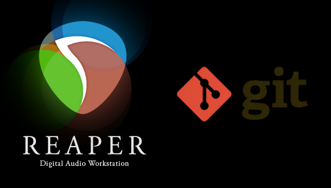

This is a plugin built for musicians and producers who want to:

- Restore old versions of projects to go through ideas that were left behind
- Have a central backup of projects either on your home or a cloud service
- Collaborate asynchronously with other producers directly on DAW

## How to Install

Download the [latest release]() for your operating system. It's a single file, which should be added to the `UserPlugins` folder of reaper.

- Windows: `C:\Users\XYZ\AppData\Roaming\REAPER\UserPlugins`
- Linux: `/home/XYZ/.config/REAPER/UserPlugins`

## How to Use

Watch some videos on [how git works](https://www.youtube.com/watch?v=hwP7WQkmECE).

After installing the plugin, the main panel should be available on the 

### Creating a local Repository

You can manage your repositories locally, so they never leave your hard drive.
Simply create a Reaper project and save it in any folder you want. It also works for previously created projects.

Then go to the plugin panel, and click the button `Project > Add Git to this Project`:

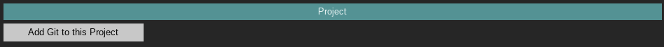

You should have the git repository setup with a `master` branch and a initial commit (containing the initial state of the project):

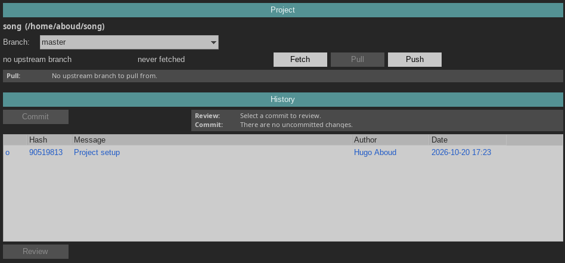

### Modifying the project

After you make changes to your project and save them, the history will show a `Uncommited changes` item:

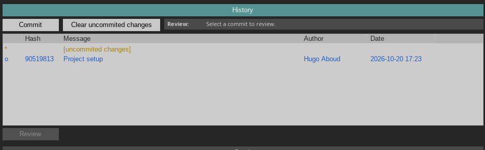

You can either _commit_ or _clear_ these changes.

#### Commit

Commiting a change means it will be added to the history with your name, a message and the current timestamp.

You can do so by clicking the `Commit` button, which opens a dialog asking for the commit message:

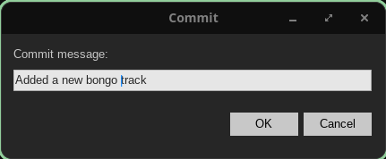

After confirming, you should have a new commit on the history:

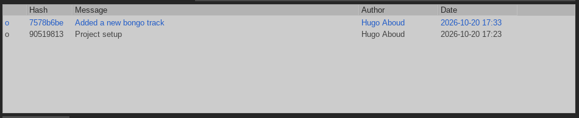

#### Clear

Clearing changes means the _uncommited_ changes are discarded, and the project goes back to the HEAD commit (in blue).

### Reviewing old commits

The `History` section allows you to navigate through old commits, and when selecting one of them the `Review` button becomes available.

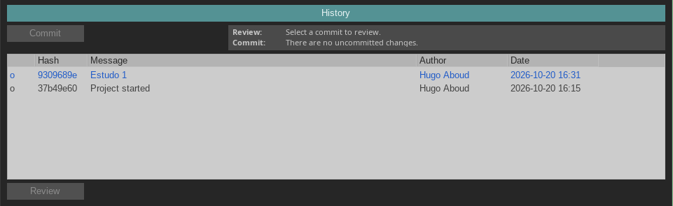

Clicking it will load the project on that commit, so you can check things.

> :warning: You SHOULD NOT modify the project while reviewing a commit, since you won't be able to commit these changes. Make sure to go back to your branch head - selecting it on the dropdown menu of the Project section - before modifying the project.

### Managing branches

The `Project` session allows you to identify your current branch (or commit, if you're in review state) and change it from the dropdown menu.

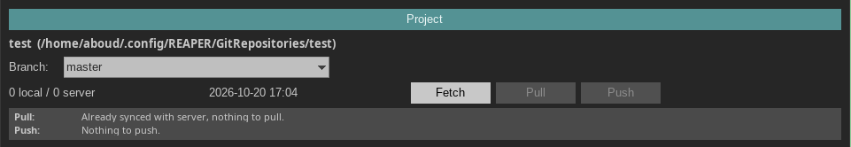

The buttons are common git operations:
- `Fetch`: Refreshes the state of the remote repository, but doesn't make any changes
- `Pull`: Pull new remote commits from the remote repository
- `Push`: Push new local commits to the remote repository

These only work if the project has a remote, as will be described below.

### Adding a local repository

On the `Repositories` section, you can click the `Add from Disk` button:

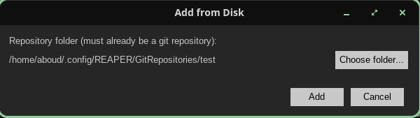

The folder must contain a git repository with one Reaper file on the root.

### Adding a remote server

You can configure authentication to a remote git server in order to backup your work and collaborate with others, through the `Servers` section:

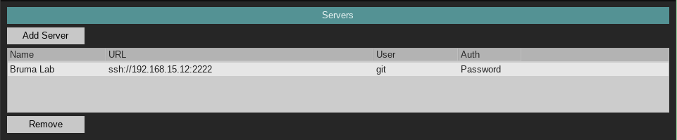

In order to add a new server, click `Add Server`:

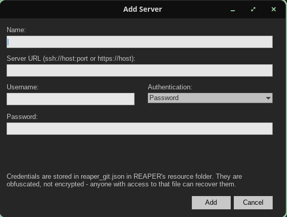

When clicking `Add`, the plugin attempts to authenticate with the server. If the authentication is sucessfull, it's added to the list.

### Cloning a remote repository

On the `Repositories` section:

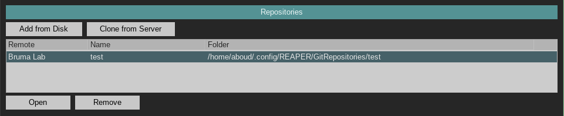

You can use the `Clone from Server` button to clone a repository into a local folder, so you can work on it locally and `Pull/Push` changes.

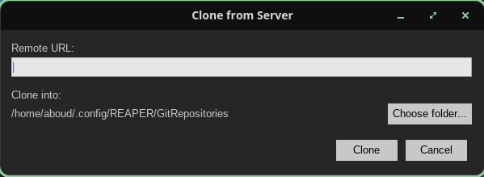

### Stashing changes

When you have uncommited changes and try to review a commit or go to a different branch, the plugin offers you two options:

- Commit: add your change to the history permanently
- Stash: save your changes aside, so they can be recovered later

The `Stash` section shows stashed commits, which can be recovered later when not in review mode.

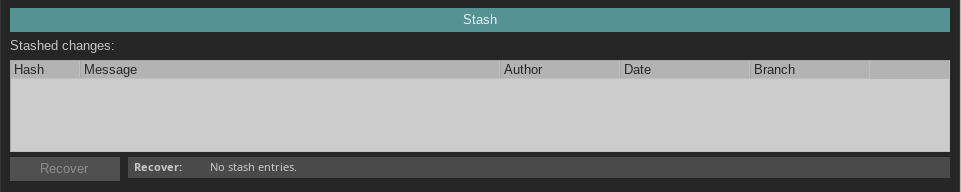


## How to Contribute

There are 3 ways you can contribute:

- Share with your friends
- [Buy me a coffee](https://www.paypal.com/donate/?hosted_button_id=BYN9HW988KHHE)
- Contribute with code, docs, translations, issues, etc.

## How to Build

> The build was only tested on Linux (cross-compiled for Windows).

Clone the repo and run:
```sh
sh scripts/build.sh
```

If you're on Linux, you can install the plugin with:
```sh
sh scripts/install.sh
```

## How to Run a Local Git Server

Check the `server` folder.